# Beyond the Obsessed Encoder: Let Control Shape the Latent Space

*By Changchen Song and Jiahang Cao*

*Independent research inspired by [Enigma Incorporated's original post](https://www.enigma.inc/posts/obsessed-encoder) · October 2026 pilot · [Presentation](assets/project-presentation.pdf)*

**TL;DR.** A visual world model can predict well, avoid representation collapse, and still organize its latent space around a feature that has nothing to do with control. On Tagged PushT, a 5×5 episode-constant color patch coincides with a JEPA baseline's planning success falling from 96% on clean data to 4%. We use action-derived objectives to define a local control direction, then prevent prediction from updating the shared encoder along that direction. In a single-seed pilot, Tagged PushT success reaches 88%, while changing only the tag is much less likely to change the planner's decision.

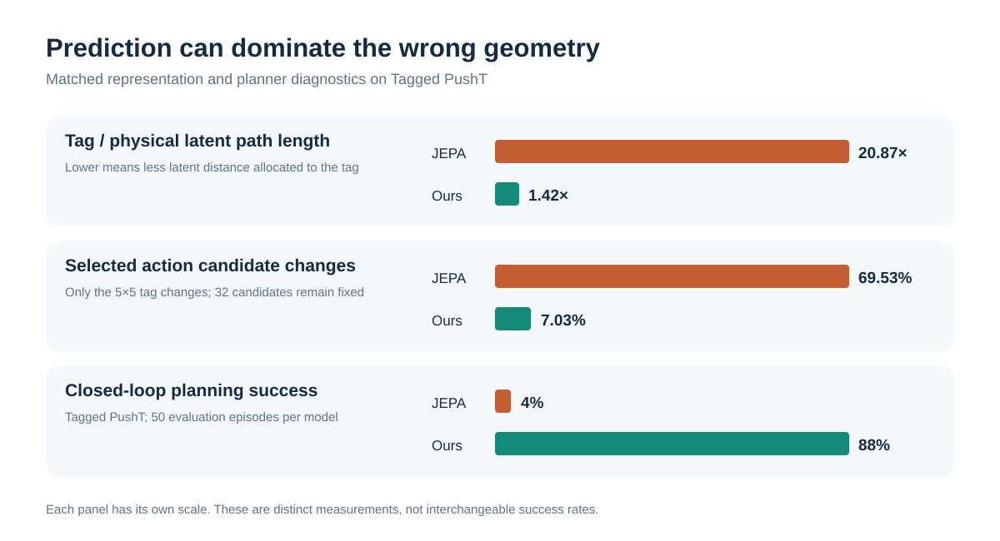

*Figure 1. Three measurements of the same failure and its mitigation. The panels have different scales and denominators: full-space latent path length, fixed-candidate counterfactual decisions, and closed-loop task success.*

## A tiny patch with an outsized effect

Imagine a robot trying to push a T-shaped block to a goal. We add a 5×5 RGB square in the corner of each observation. Its color is fixed within an episode and varies across episodes. The patch changes no action, physical trajectory, goal, or success condition. It is deliberately easy to predict and useless for acting.

This is a controlled modification of PushT rather than a new physical environment. We retain the expert trajectories and actions. The RGB value is selected reproducibly from the episode identity and inserted into the observation during data loading. Both training and evaluation use tagged observations, so the question is not whether the model survives a tag appearing only at test time. It is whether a persistent but task-irrelevant visual factor redirects what the representation learns during training.

<figure>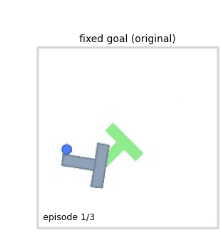<figcaption>Original PushT observation</figcaption></figure>
<figure>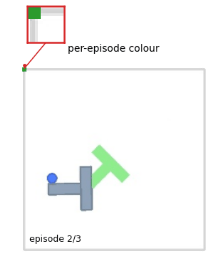<figcaption>Tagged PushT: a 5×5 episode-constant RGB patch in the top-left corner</figcaption></figure>

*Setup illustration. These are frames from different episodes, so their physical poses differ. In the controlled dataset, the sole added factor is the corner patch; actions, dynamics, goals, and success criteria are unchanged.*

Yet the baseline world model becomes preoccupied with it. The encoder remains non-collapsed: different observations still produce different representations. The problem is **allocation**. Latent distance responds strongly to the persistent patch and weakly to physical motion. A planner that compares predicted and goal latents inherits this distorted geometry.

Our motivation comes from [Enigma Incorporated's *The Obsessed Encoder*](https://www.enigma.inc/posts/obsessed-encoder). This is an independent follow-up: if predictive learning discovers an easy shortcut, what tells the shared representation which changes matter for action? Our answer is to use evidence already present in action-labeled trajectories.

### The world-model loop

The current and future observations pass through the **same encoder and projector**, yielding $z_t$ and $z_{t+h}$. An action-conditioned predictor takes $z_t$ and the intervening action sequence and produces $\hat z_{t+h}$. Prediction training aligns $\hat z_{t+h}$ with the actual future encoding $z_{t+h}$; it does not simply pull $z_t$ and $z_{t+h}$ together. SIGReg acts on the encoded representations to discourage global collapse.

For planning, we sample candidate action sequences, roll each through the predictor, compare the predicted endpoint with a goal latent, execute the first action of the best sequence, and repeat. This is online CEM planning in a learned latent space. A low prediction loss is useful, but planning additionally requires distances between latents to respond to the physical differences that matter for action.

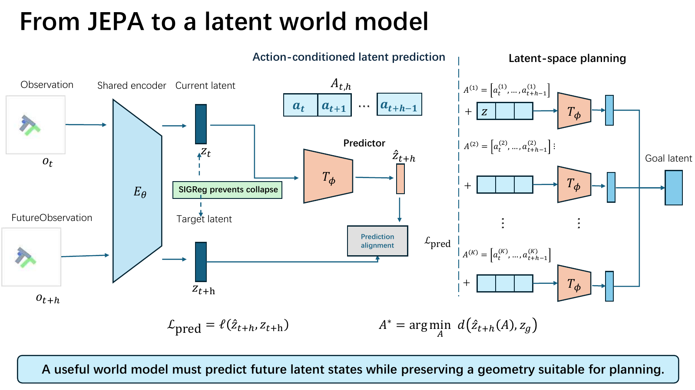

*Figure 2. The encoder supplies the geometry used by both prediction and planning. The predictor estimates future latents for candidate action sequences; the planner ranks the resulting endpoints against a goal.*

## Why prediction can choose the wrong feature

In an action-conditioned latent world model, an encoder maps an observation $o_t$ to a latent $z_t$. A predictor receives $z_t$ and an action sequence $A_{t,h}$ and predicts a future latent. Training aligns that prediction with the encoded future observation. At planning time, the model evaluates candidate action sequences by the distance between their predicted endpoints and a goal latent.

Persistent features are attractive to a temporal alignment objective. For a standardized scalar feature $u$ whose values at two paired times have correlation $\rho_u$, direct squared alignment has expected cost $2(1-\rho_u)$. A feature that hardly changes has low alignment cost. This identity illustrates the preference; it is **not** the complete loss of an action-conditioned predictor.

There is a positive theoretical picture too. Under specific Gaussian latent and transition assumptions, [Klindt, LeCun, and Balestriero](https://arxiv.org/abs/2605.26379) show how LeJEPA's alignment plus Gaussian regularization can recover a world latent up to an orthogonal transformation. Orthogonal transformations preserve Euclidean distance, exactly the property latent-space planning would like. That result supplies an ideal case, not a theorem about our action-conditioned PushT setup. Our episode-constant patch deliberately creates a factor with a different temporal correlation from the changing physical state.

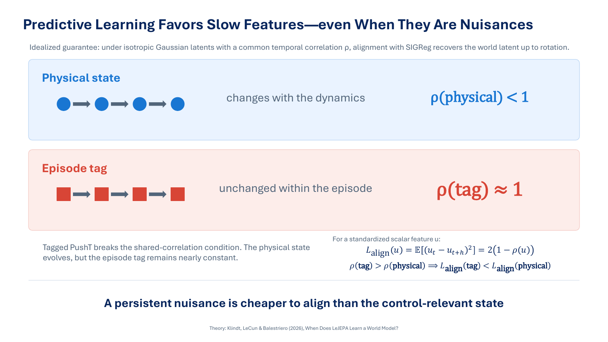

*Figure 3. For a standardized feature direction, stronger temporal correlation lowers the direct alignment cost. The slide illustrates the optimization pressure; the complete predictive model also conditions on actions.*

On Tagged PushT, the physical state evolves under actions, while the patch is constant during an episode. The patch is therefore a slow, predictable factor. SIGReg can prevent the trivial solution in which every observation maps to one vector, but a healthy aggregate embedding distribution does not specify *which* factor should occupy its geometry. The [LeJEPA identifiability result](https://arxiv.org/abs/2605.26379) gives a positive guarantee under particular latent distributions and transition assumptions. Our controlled nuisance violates the shared temporal-structure intuition behind the idealized setting; we do not claim to extend that theorem to our action-conditioned model.

We measure the misallocation directly. Across matched sweeps, tag-only changes produce **20.87×** the full-space latent path length of comparable physical changes in JEPA. A separate tag-only probe fixes the physical pixels and varies RGB values: local changes are estimated at about **2.88 dimensions**, yet their global covariance spans about **49.85 effective directions**. The latter is an empirical effective-dimension statistic, not a claim that the tag contains 50 independent physical variables.

For the path measurement, a smooth intervention produces latents $z_0,\ldots,z_T$. We sum $\lVert z_{i+1}-z_i\rVert_2$ in the **full projector space**, normalize by a shared reference scale, and compare matched tag-only and physical-content sweeps. A PCA plot is only a two-dimensional view. For the folding probe, local intrinsic dimension is estimated from nearest-neighbor distance ratios; global effective dimension is the participation ratio of the tag-induced covariance eigenvalues, $(\sum_i\lambda_i)^2/\sum_i\lambda_i^2$. The resulting ratio of global to local dimensions is an empirical folding signature, not a topological proof.

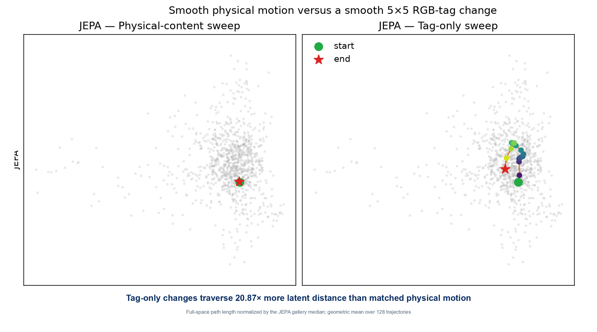

*Figure 4. In JEPA, a smooth physical change barely moves the projected latent, while a tag-only change traces a visible path. The 20.87× statistic is computed from path lengths in the full latent space over 128 matched trajectories; the projection illustrates the behavior but does not define the metric.*

## Give control a say in the shared encoder

We add two forms of action-derived evidence. An **inverse-action** objective asks whether the start and endpoint latents retain enough information to recover the intervening action. A **reachability** objective asks which candidate future state follows from a start state and action sequence. Neither objective requires privileged object-position labels from the simulator.

The inverse head predicts the action sequence from $(z_t,z_{t+h})$ and receives a Smooth L1 loss against the observed actions. Reachability reverses the question: given $z_t$ and the actions, which endpoint actually followed? In the configuration reported here, each query selects among **four states from the same episode**: one correct future endpoint and three other-time candidates. They all share the constant tag. A tag-only strategy therefore cannot pick the correct endpoint; the model must preserve action-conditioned distinctions among states. This is an endpoint-identification task over observed candidates, not an estimate of an entire reachable set.

Together they form $L_c=L_{\mathrm{inv}}+\lambda_rL_{\mathrm{reach}}$. Prediction still supplies rich variation. These two action-based tasks say what the shared representation must keep distinguishable for control.

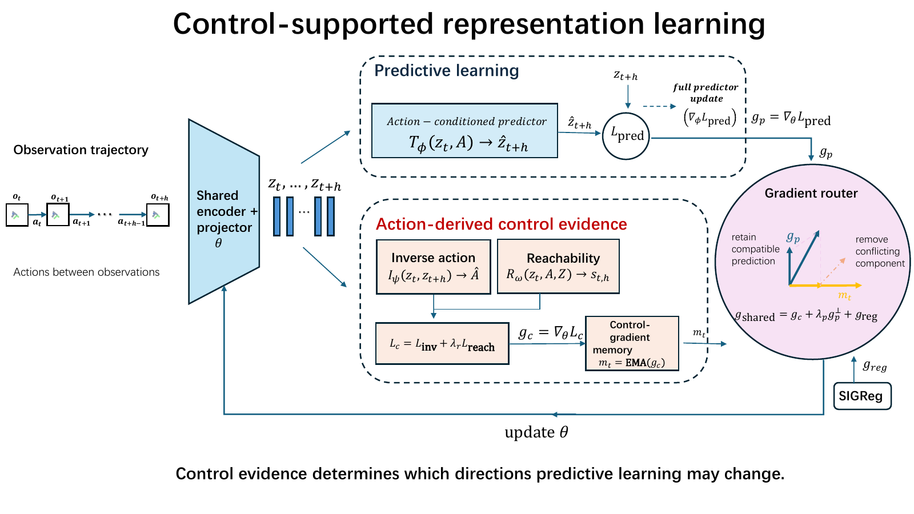

*Figure 5. The full training pipeline. Prediction, inverse action, reachability, and SIGReg all touch the shared representation, but only prediction's gradient on shared encoder parameters is routed. Predictor-private parameters keep their full prediction update.*

These objectives provide a control loss $L_c$, but simply adding $L_c$ to prediction does not resolve how competing gradients modify the *shared* encoder. We therefore route only the predictive gradient on its parameters $\theta$:

$$
g_c=\nabla_\theta L_c,\qquad g_p=\nabla_\theta L_{\mathrm{pred}},\qquad
m_t=\beta m_{t-1}+(1-\beta)g_c,
$$

$$
g_{p\perp}=g_p-\frac{g_p^\top m_t}{\lVert m_t\rVert^2+\epsilon}m_t.
$$

Here $m_t$ is an exponential moving average of the **control gradient**. It smooths the reference direction across minibatches; it is not an EMA of target-encoder parameters. The control gradient still updates the encoder in full. The predictor's private parameters still receive the full prediction gradient. Only prediction's contribution to the shared encoder loses its component along the control reference.

Including the regularizer, the shared update is proportional to $g_c+\lambda_p g_{p\perp}+g_{\mathrm{reg}}$. This asymmetry matters. We do not turn down all predictive learning to make control win by brute force. We limit one way prediction can directly rewrite a locally control-sensitive direction, while leaving its other parameter directions and its private predictor available.

Why does this make sense? Near the current parameters, the first-order change in control loss from a small prediction-only step depends on the inner product between $g_c$ and that step. If the reference $m_t$ equals $g_c$, the routed prediction step is orthogonal to it, so that first-order term vanishes. In practice $m_t$ is approximate and the optimization landscape is curved. This is a **local first-order explanation for one protected direction**, not a guarantee that control loss never rises or that we have identified every control-relevant factor.

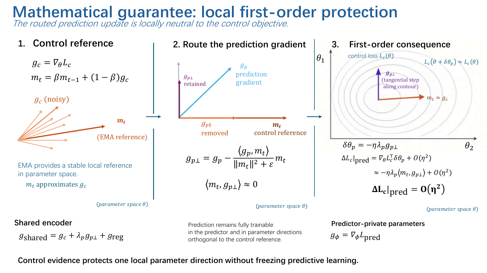

*Figure 6. The EMA provides a smoother local reference than a single minibatch control gradient. The router removes prediction's component along that reference. Exact first-order neutrality requires the reference to equal the current control gradient and a sufficiently small step.*

## Follow the evidence from features to decisions

We evaluate three different questions: **Is physical state readable? What organizes latent distance? Does the nuisance change a planning decision?** Closed-loop success then tests whether the resulting representation remains useful for behavior. A linear probe alone cannot answer all four. In the reported pilot, we use frozen representations for probes and planning, 128 matched trajectories for the path comparison, fixed banks of 32 actions for decision interventions, and 50 episodes per task for online CEM success. These protocols answer different questions and their percentages must not be conflated.

**Information present.** With frozen projection-space representations on Tagged PushT, mean linear-probe $R^2$ for pusher position, block position, and block angle rises from about **0.15** for JEPA to **0.88** for our model. The tag remains readable: its RGB probe $R^2$ changes only from about **0.95** to **0.92**. The method is not merely deleting color information.

To compute a probe, we freeze the encoder and projector, fit a linear regressor on a training split, and evaluate $R^2=1-\sum_i(y_i-\hat y_i)^2/\sum_i(y_i-\bar y)^2$ on held-out samples. A value of one is perfect; zero matches a constant-mean prediction; negative values are worse. JEPA's block-angle probe is negative, while ours becomes positive. High tag $R^2$ after training is an important control: the tag may remain decodable without dominating planning.

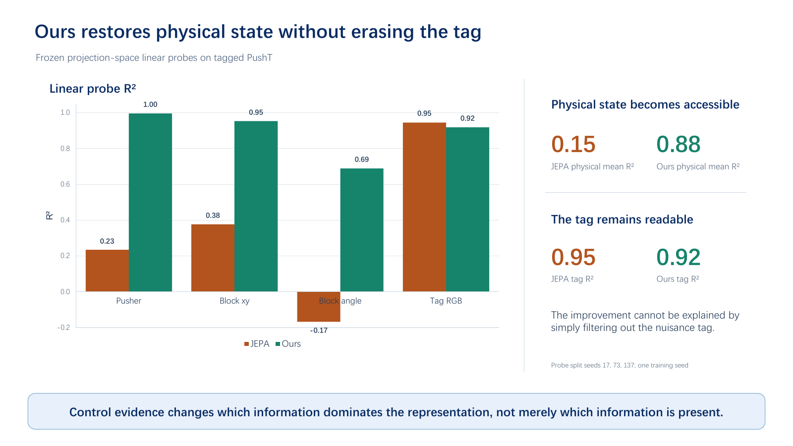

*Figure 7. Physical state becomes easier to read from frozen representations, while the tag remains linearly readable. Decodability alone does not establish which feature controls the metric or the planner.*

**Geometry allocated.** The matched tag-to-physical latent path-length ratio falls from **20.87×** to **1.42×**. This ratio uses paths in the full representation space, not distances measured on a two-dimensional PCA plot. In paired-image comparisons, shared physical content becomes more similar despite different tags (centered cosine **0.021 → 0.469**), while shared tag identity becomes less similar when physical content differs (**0.852 → 0.215**).

The centered-cosine tests deliberately swap what is held constant. In one set of image pairs, physical content is fixed and tag color changes; in the other, tag color is fixed and physical content changes. We subtract the representation mean before taking cosine similarity. JEPA considers images with the same tag but different content much more similar than images with the same content but different tags. With our model, that relationship reverses. The result is about *organization* of the representation, not whether a linear probe can still decode the color.

The tag-folding probe offers another view. When physical pixels are held fixed and only RGB varies, JEPA's tag-induced covariance has about **49.85 global effective directions** and a **17.30×** global-to-local dimension ratio. In our model these fall to about **6.67 directions** and **2.29×**. The tag's latent effect is not forced to zero; it is much less spread across the global geometry. These are comparative effective-dimension diagnostics, not proof of a manifold's topology.

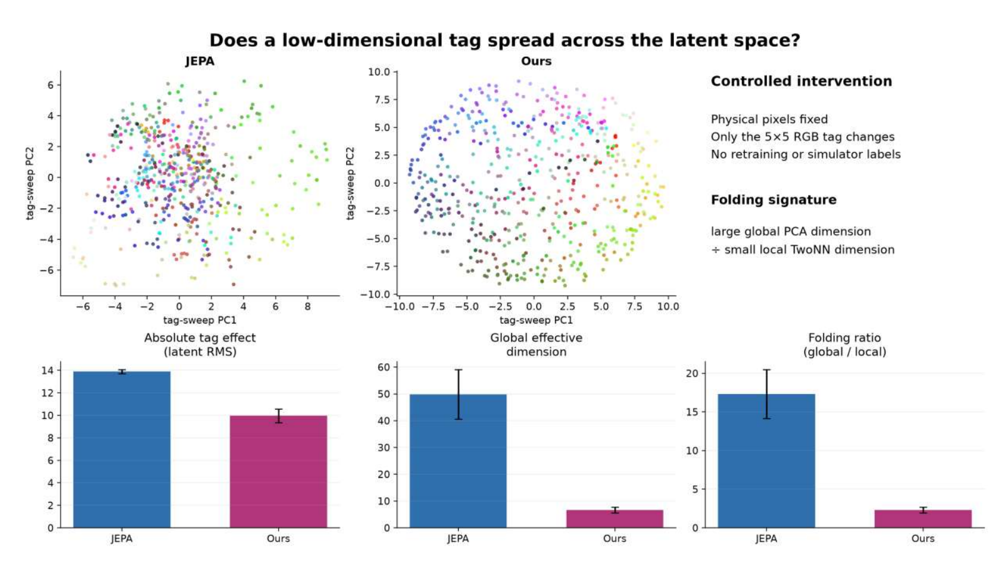

*Figure 8. The nuisance remains represented, but its variation occupies fewer global effective directions. Local dimension is estimated from neighbor distances; global dimension is a covariance participation ratio.*

**Decisions affected.** We hold the physical scene, goal, and **32 candidate action sequences** fixed and change only the 5×5 tag. The selected candidate changes in **69.53%** of JEPA cases and **7.03%** of ours. Normalized candidate-cost distortion falls from **58.36%** to **10.78%**; pairwise ordering reversals fall from **9.84%** to **2.27%**. These are offline matched interventions, not additional closed-loop success rates.

We also perturb spatial tiles one at a time and measure how candidate planning costs respond. In the matched scene illustrated below, the tag accounts for **91.8%** of JEPA's spatial sensitivity, versus **17.6%** in our model; its absolute cost effect falls from **68.43** to **0.77**. This is an illustrative scene-level comparison, not the aggregate rate across evaluation clips. The planner can still see the tag, but the example shows costs responding more to task-relevant scene content under our model.

For each tile, we keep the scene and candidate actions fixed, perturb that region, and recompute candidate planning costs. The tag share is its share of total spatial sensitivity across tiles in this scene; the absolute effect measures the magnitude of its impact on cost. The heatmaps and the two pairs of numbers all describe the same matched example. The fixed-candidate intervention rates above provide the aggregate decision evidence.

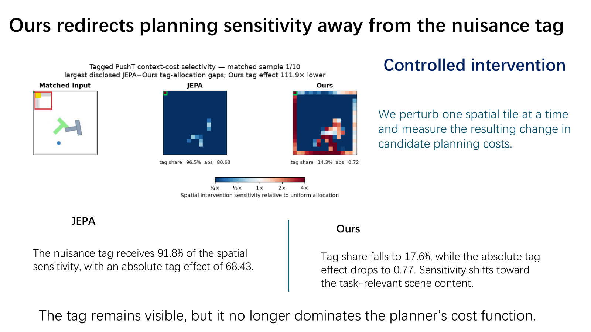

*Figure 9. In this matched scene, JEPA's planning-cost sensitivity concentrates on the corner tag; our model responds more to the pusher and block. This illustrates what the planner uses rather than what the encoder can decode.*

For the fixed-candidate decision test, let $a$ and $b$ be the vectors of 32 candidate costs before and after changing the tag. “Selected candidate changed” checks whether $\arg\min_i a_i$ differs from $\arg\min_i b_i$. Cost distortion is the root-mean-square difference between $a$ and $b$, normalized by the standard deviation of the reference costs. Pair-order reversal is the fraction of non-tied candidate pairs whose relative ordering flips. The three measurements respectively test the final choice, the cost landscape, and the ranking.

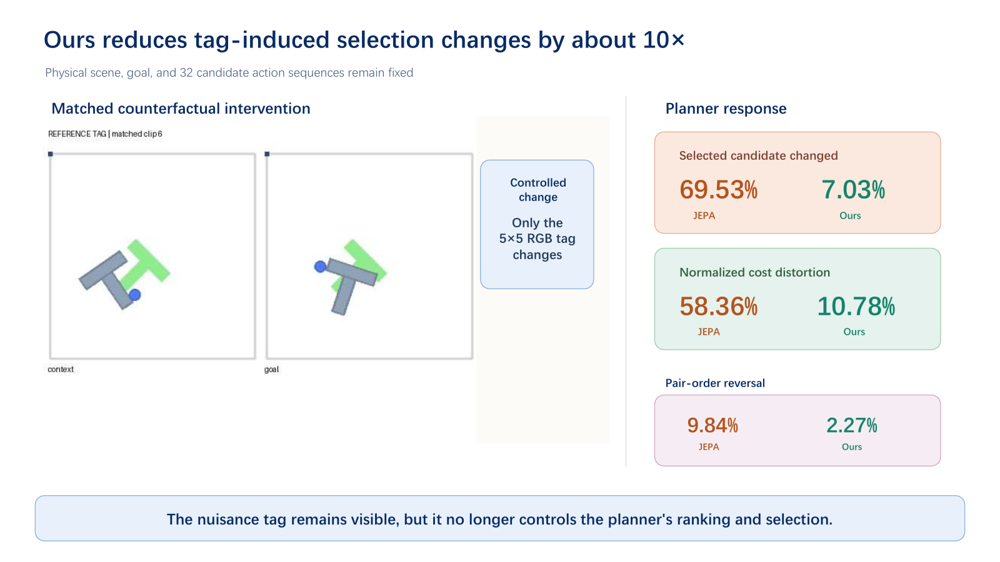

*Figure 10. With the physical scene, goal, and action bank unchanged, changing the nuisance tag much less often changes our model's selected candidate or relative costs.*

**Behavior retained.** Under the reported online CEM evaluation, our model succeeds on **44 of 50 Tagged PushT episodes (88%)**, compared with **4%** for the JEPA baseline. The same method reaches **92%** on Clean PushT, **88%** on Reacher, **96%** on TwoRoom, and **80%** on Cube, each over 50 evaluation episodes. These are pilot results, not a claim of state-of-the-art performance across tasks or robots.

The clean tasks matter because a trivial way to resist the tag would be to suppress predictive learning or freeze the representation. Instead, the learned model still supports planning when the synthetic nuisance is absent. The clean-task baseline comparisons are informative but not all from a fully matched protocol, so our strongest causal evidence remains the controlled Tagged PushT interventions.

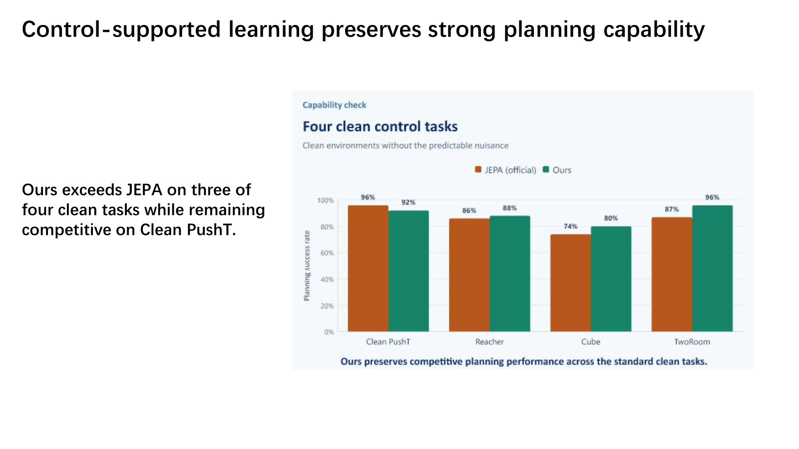

*Figure 11. The routed model retains strong pilot performance across clean tasks. The main comparison is within the controlled Tagged PushT setting; cross-source clean baselines should be treated cautiously.*

### Four example rollouts

The animations below show two successful episodes per task under our model. They are qualitative examples of the online planner in motion, not matched JEPA-versus-ours comparisons or additional success-rate measurements. The percentages above come from the full 50-episode evaluations.

<figure>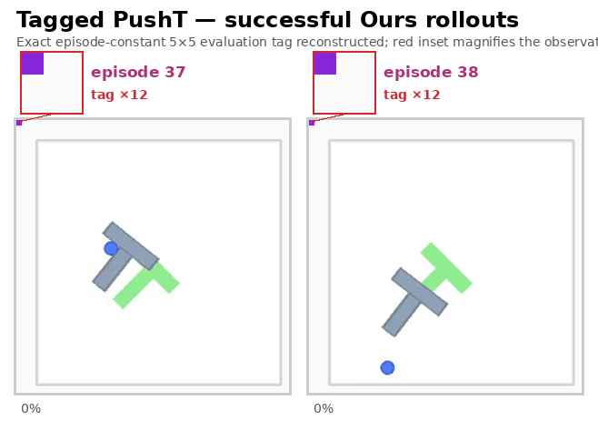<figcaption><strong>Tagged PushT.</strong> The 5×5 tag remains visible during both successful pushes.</figcaption></figure>
<figure>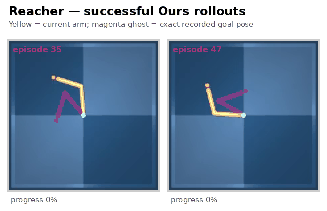<figcaption><strong>Reacher.</strong> The controlled arm reaches the recorded goal pose.</figcaption></figure>
<figure>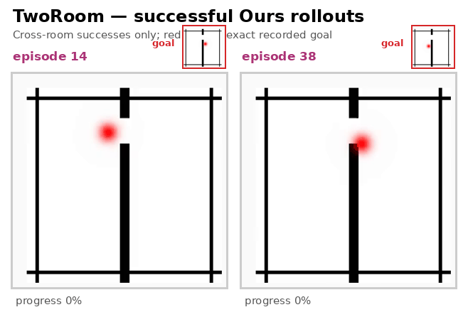<figcaption><strong>TwoRoom.</strong> Both examples cross between rooms.</figcaption></figure>
<figure>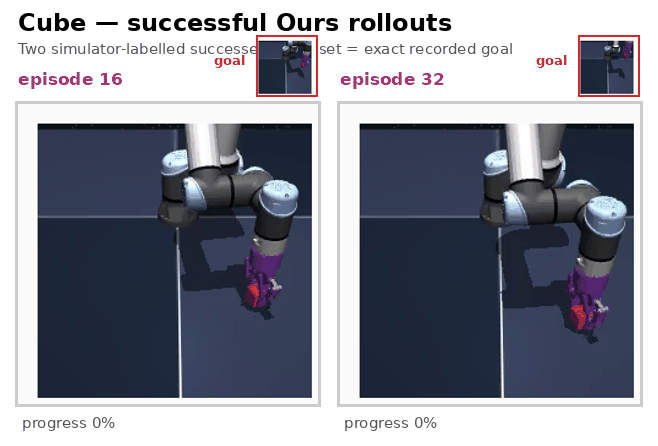<figcaption><strong>Cube.</strong> Two successful manipulation trajectories.</figcaption></figure>

## What this result does, and does not, establish

The 5×5 tag is a deliberately controlled nuisance. It lets us change one visual factor while keeping the physical trajectory and candidate actions fixed. Real control data contain camera motion, lighting, backgrounds, object identity, and task context; some persistent factors genuinely matter for action. Our router does not classify features as nuisances or guarantee that all useful geometry is preserved.

The main planning results use **one training seed**, evaluation seed 42, and **50 episodes per task**. Some clean-task baseline comparisons come from different experimental sources, so we do not treat them as fully matched superiority claims. More seeds, stronger baselines, larger visual domains, and cross-robot tests are needed before making broader generalization claims. This post reports the parameter-space EMA router and the saved October presentation; later experimental variants are separate and their results are not pooled here.

What the present evidence supports is narrower and useful: action-derived objectives can provide a local criterion for how prediction updates a shared representation. In this controlled setting, that criterion reduces nuisance dominance in latent distance, planner costs, and action selection while retaining predictive learning.

**Predict what you can. Represent what changes decisions.**

---

### Sources and project materials

- [The Obsessed Encoder](https://www.enigma.inc/posts/obsessed-encoder), Enigma Incorporated.
- [When Does LeJEPA Learn a World Model?](https://arxiv.org/abs/2605.26379), Klindt, LeCun, and Balestriero.
- [LeWorldModel](https://arxiv.org/abs/2603.19312) and its [official code](https://github.com/lucas-maes/le-wm).
- [Project presentation: *How Do We Fix an Obsessed Encoder?*](assets/project-presentation.pdf) (October 2026). Figures and reported metrics above follow the presentation and its saved experiment audit.

